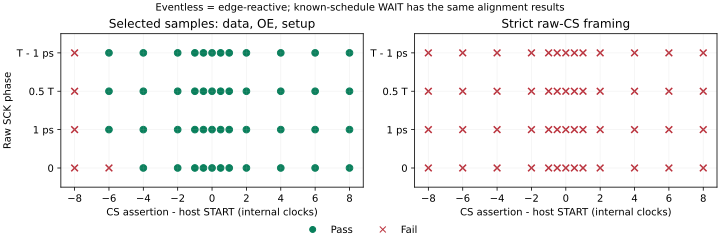

# Eventless CS-framed SPI utility gate: final A–N report

## A. Executive classification

**EVENTLESS_SPI_FRAMING_INSUFFICIENT. NO-GO; architectural work ends.**
The existing descriptor provides useful edge reaction, but does not satisfy
autonomous CS-framed repetition. Normal release leaves OE driven for 2–3
internal clocks; a new frame requires host START. Aborted frames can emit
inside the synchronization interval after raw release. These are documented
existing semantics, not bugs invalidating M2/M3. This is not M4.

## B. Repository / PR state

M3 PR [#5](https://github.com/wellitsabhinav/CHRONOS-Guarded-Temporal-IO/pull/5)
was merged at df29e14cea7e13489e1b128a590f1f13c3e58681 after all six checks
passed at 4fc2bc76c376a8bcd048d0ded34af00d19ce9164. Its last change restricted
automatic physical builds to historical M0 production inputs; the merge
launched no physical run. Prior M0/M1/M2 merges remain reachable. The M3
branch was removed only after ancestry verification. The earlier M0 run
38167141838 completed successfully, including GDS/precheck/gate tests/viewer.

This gate starts from that updated main on
development/eventless-cs-framed-spi-gate, with preregistration commit 22d4822
before experiment execution. Draft PR
[#6](https://github.com/wellitsabhinav/CHRONOS-Guarded-Temporal-IO/pull/6)
preserves the final experiment and archival documentation. Build traces,
PDK/tool installations and waveforms remain ignored.

## C. Frozen architecture

Production RTL and historical M2/M3 evidence are byte-for-byte unchanged
relative to the frozen ancestor. M3 remains
CHRONOS_M3_TIMING_CONTRACT_ESTABLISHED_NO_BASELINE_ADVANTAGE: CHRONOS/WAIT
88/160, edge-reactive 98/160, coordinated all-phase period 8 clocks, no
unique timestamp precision advantage. No ISA, queue, sampler, production
protocol FSM, clock-domain or physical changes were made.

## D. Eventless mechanism

The candidate **is** test/m3_eventless.v, M3's edge-reactive baseline.
Those labels identify one implementation, not competing architectures.
START latches a general descriptor: two full GPIO actions, comparison,
four inversion bits, length and selected trigger/emit edges. The selected
command decides the first action; subsequent falling edges advance the
sequence. Synchronized CS release clears OE/activity. Completion/cancellation
never sets armed again. START during activity restarts and clears output;
there is no busy rejection, timeout, opcode parser, FIFO or timer.

## E. External peer and validation

The independent peer owns raw CS/SCK/MOSI and exact sampling times.
Commands 0/1 select LSB-first 0x6/0x9. At P=8 clocks, the command rise is
CS+4 clocks+phase, with four response samples at command+8,+16,+24,+32.
Nominal release is CS+38 clocks+release phase. Sample correctness requires
public MISO, OE and at least one-clock stable setup; after abort it requires
OE=0. Strict framing also requires zero OE throughout raw CS-high intervals
and no driven output transition after abort. Nothing masks OE with CS.

195 bounded cases compare **20,515 internal edges** against both independent
M3 behavioral models, checking all exposed state each edge. The CSV contains
**2,112 public sample observations**, 1,056 per path. Simulation regression
PASS means the measured behavior matches the models and decisive negative
witnesses; it does not mean the utility gate passed. Initial harness reset
settling was repaired before final qualification; no comparator was repaired.
Exact ties drive raw input and sample public output before the internal
edge. +/-1 ps witnesses expose that digital convention; there is no analog
metastability/electrical qualification.

## F. Alignment methodology and result

The 13-point coarse delta grid spans -8 to +8 clocks, four raw phases
(0, 1 ps, half-clock, clock-1 ps), and both commands: **104 points**.
18 local refinements test -6 clocks +/-1 ps and adjacent half/whole clocks.
Payload passes are **94/104**, and **10/18** at refinement, for both candidate
and known-schedule WAIT. Strict normal framing passes are **zero**.

Let H be the clocked START edge, E the raw command rise, and
C(E)=ceil(E/Tclk)*Tclk under the stated tie convention. Stage1 captures at
C, stage2 at C+Tclk, and command decision/first eventless action at
R=C+2*Tclk. START wins over capture on the same edge; the command requires
H<R. With command lead 4 clocks this gives **delta+phase > -6*Tclk**.
The phase-independent initial payload window within the sweep is
**(-6,+8] clocks**. At delta=-6 exactly, phase 0 fails and positive phases
pass; at -6 clocks+1 ps, both values pass. Later positive offsets have no
descriptor timeout, but the tested upper bound is +8, not an unbounded proof.

First-bit setup is (5,6] clocks; the minimum observed complete-response setup
is **1.0001 clocks**. Later emitted actions have setup (1,2] clocks. Exact
action timing depends on raw edge phase, rather than an absolute timestamp.



## G. Repeated transactions

48 repetition cases include alternating 16-frame and same-value 8-frame
trains, long idle, release phases, gap/rearm boundaries and eight turnaround
phase corners. With host START each frame, all **64 alternating bits** and
**32 same-response bits** pass without reset, as does an 80-clock idle gap.
The three-frame train with only the initial START gives **[pass,fail,fail]**
for both responders. Thus CS-only indefinite repetition is unsupported.
Finite successful restarted trains plus the one-shot state semantics support
host-controlled repeatability, not a proof of indefinite autonomous operation.
45/48 repetition cases pass payload; none pass strict framing.

## H. CS / OE and abort behavior

Without an intervening START/reset, raw release D clears eventless OE at
**U=ceil(D/Tclk)*Tclk+2*Tclk**, a latency in **[2,3) clocks**.
Release-phase witnesses measure 2, 2.5 and 2.0001 clocks; normal 1-ps-after-edge
release measures 2.9999. Host START/reset can clear it sooner and is recorded
separately. For a normal phase-1 frame: raw command 44.0001, stage1 45,
stage2 46, decision/first action 47, later actions 59/67/75, samples
52.0001/60.0001/68.0001/76.0001, release 78.0001, OE off/idle 81 clocks.

Abort at 45.0001 still admits the already synchronized command at 47 and
drives until 48. At phase 0, abort immediately before the action at 58
clocks (-1 ps), or exactly at 58, leaves a driven MISO transition at 58;
OE clears at 60. Candidate emission stops after synchronized cancellation,
with no timestamp queue to replay later. This is bounded synchronization
leakage, and fails raw-CS ownership. WAIT continues its known schedule after
abort and retains OE until reset; START also preserves WAIT output/OE.

Missing/extra SCK corrupts eventless response sequencing; WAIT follows its
known schedule despite such edges. Missing CS release holds the final drive.
A short pulse entirely between capture edges can be missed. An extra command
clock is not rejected as an unsupported encoding: the descriptor accepts a
Boolean comparison, with no richer command grammar. Reset clears outputs on
its internal edge, aborting the nominal response; restart after reset works.
Missing edges have no autonomous timeout/fail-closed guarantee. Every directed
case retains observed OE exposure and driven late transitions in evidence.
Five adversarial ownership passes are safe no-drive early aborts; they are
not completed four-bit framed responses. Missing CS release is explicitly
ineligible for strict success, even though CS-high exposure is then vacuous.

## I. Rearming boundary and spacing

There is **no finite safe autonomous transaction spacing** under the requested
strict contract: more idle time does not restore armed state, and raw release
still leaves OE high. The shortest tested sample-only spacing, 38 clocks+1 ps,
uses a zero-length CS-high gap and a new START. It is not a CS-framed result;
the supposed release/assert assignments collapse to a continuously low CS.

A weaker host-controlled envelope works with **three clocks of bus-idle
turnaround**, START at ceil(prior release)+2 clocks, then a new command four
clocks after assertion. Eight SCK/release phase corners pass; OE is already
zero at the next assertion. This conservative tested spacing is
**41 to just under 42 clocks between assertions**. It is not an optimized
minimum or a shared-bus autonomous contract, and still permits the measured
2–3-clock drive after raw release.

Rearming must also avoid the old final sampling rise. At phase 1 the old final
rise resolves at 79 clocks. START at 78 clears the previous output but captures
that old rise at 79 as a new command; the later frame fails. START at 79 wins
the tie and the next frame passes. All next STARTs must also precede the new
command's decision. A CS-high pulse >=one clock guarantees digital capture
over phase; a shorter pulse may disappear. Host restart can hide that missed
pulse in sample-only tests, so those passes do not establish framing.

## J. Fair baseline comparison

| Property | Eventless / edge-reactive (same RTL) | Relative-WAIT |
| --- | --- | --- |
| Initial payload window | delta+phase > -6 clocks | Same measured window |
| Advance future-edge schedule | Unneeded | Required; generously supplied per frame |
| Minimum normal measured setup | 1.0001 clocks | 3.0001 clocks |
| Raw CS release ownership | Fails; clears after 2–3 clocks | Fails; no automatic clearance |
| Autonomous rearm | Absent | Absent |
| Repeated sample-only trains | Host START per frame | Host START per frame |
| Missing/extra edge | Follows edge; sequence can corrupt | Continues planned schedule |
| Timestamp/FIFO | None | None |

WAIT receives first_delay=ceil(first falling edge)-START, spacing 8, with
first_delay clamped to one when the requested edge is already past. This
schedule privilege is explicit and favorable to WAIT. Its cancellation and
START semantics are unchanged. Eventless cancels sooner and costs less than
this WAIT implementation, but cannot outperform its identical edge-reactive
baseline or meet the governing autonomous framing requirement.

## K. Complexity accounting

| Test-only mapped implementation | Cells | Flops | State bits before optimization | Area µm² | Queue bits |
| --- | ---: | ---: | ---: | ---: | ---: |
| Eventless = edge-reactive | 631 | 151 | 152 | 13,099.968 | 0 |
| Relative-WAIT | 950 | 193 | 194 | 16,142.679 | 0 |

Both preserve complete programmable actions, all descriptor/debug ports and
two 8-bit synchronizer banks. WAIT's wrapper adds only those shared frontend
banks; no new functional behavior. State includes synchronization/history,
saved actions/configuration, index/status/output; WAIT adds saved spacing
and a 24-bit countdown. CMOS5L Liberty SHA256 is
34163f3e7de9f854afac57332ba06f1739b78e7ac35660a8a5ddd39c570124ad;
Yosys 0.30+48 and ABC 1.01 mapping/configuration/source hashes are pinned in
eventless_structure.json. Exact debug ports differ, so this is structural
accounting of these fixtures, not an area-optimal FSM comparison.

Neither needs the CHRONOS global timer/comparator/FIFO/scheduler. The frozen
M2 ordinary core mapped to 6,131 cells / 1,483 flops / 130,991.4018 µm² in the
earlier same-library screen. This descriptor is about 10% of that mapped
core area; those modules expose different functionality and ports. The
simplification is real, already represented by the ordinary edge baseline,
and does not fix framing. No P&R, routed STA or clock-rate claim was made.

## L. Practical utility assessment

Edge reaction needs less host timing knowledge than scheduled actions and
has smaller mapped state than this generic WAIT fixture. Those are ordinary
mechanism properties, not a new CHRONOS advantage. Achieving conventional
autonomous CS ownership/rearm would require changing documented architecture.
The gate deliberately records that failure instead of adding a rescue FSM.
No evidence shows a protocol emulator ASIC would benefit over an appropriately
small ordinary FSM/counter. No literature expansion or rebranding is justified.

## M. GO / NO-GO

**NO-GO.** Raw-CS framing and autonomous repetition fail. Coordinated payload
success and structural savings do not override the preregistered criterion.
There is no unique external capability versus the unchanged edge-reactive
implementation. M2/M3 stop conditions remain frozen. No successor proposal,
new milestone, architecture experiment or physical campaign is authorized.

## N. Final project disposition and reproduction

CHRONOS ends as a reproducible negative architecture exploration:

| Stage | Accepted evidence | Rejected / limited hypothesis |
| --- | --- | --- |
| M0 | Ordered future atomic GPIO survives producer inactivity; historical physical qualification | Novelty / full protocol emulator not established |
| M1 | Guard bundles and registered generation semantics work | Provisional implementation success did not establish practical advantage |
| M2 | Programmable ordinary sampling works; safe reclamation tested | Guards provide no measured margin/throughput gain; ordinary default |
| M3 | Coordinated external timing contract at P=8 clocks | Global timestamps provide no advantage over relative-WAIT |
| Eventless gate | Timer/FIFO-free edge response and coordinated no-reset trains | Strict CS ownership and automatic rearm fail; candidate is ordinary edge baseline |

The exact next action is review/retain the archival PR and end feature work.
Historical source and evidence remain available; no external repository
visibility/archive setting is changed by this documentation disposition.

```sh
pip install -r test/requirements.txt
python scripts/eventless_experiment.py
# Optional structure reproduction; existing pinned Liberty required:
CHRONOS_LIBERTY=/path/to/pinned.lib python scripts/eventless_synth.py --output docs/results/eventless_structure.json
# Optional small plot, Matplotlib 3.9.2:
python scripts/eventless_plot.py
```

Portable Icarus/Yosys overrides follow development_setup.md. Core evidence:
[preregistration](../research/eventless_spi_hypothesis.md),
[curated points/witnesses](results/eventless_gate.json),
[all public samples](results/eventless_samples.csv),
[structure/configuration](results/eventless_structure.json).
The bounded CI job reruns simulation; full traces are ignored locally and
uploaded as CI artifacts. Historical reproduction targets remain usable;
they are evidence, not permission for another campaign.
